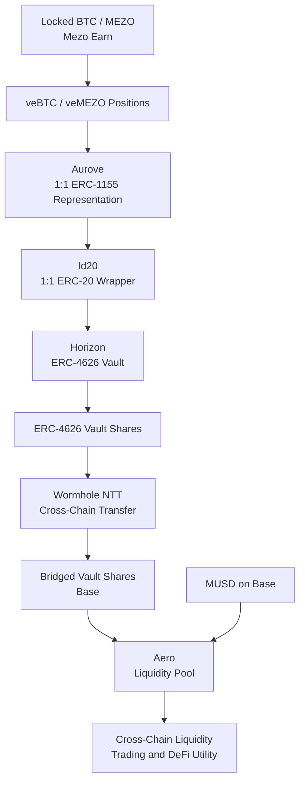

# Aurove Horizon

**Locked on Mezo. Liquid everywhere.**

Cross-chain liquidity infrastructure for tokenized Mezo Earn positions.

Horizon extends [Aurove](https://github.com/aurove)'s liquid representations of veBTC and veMEZO positions into ERC-4626 vaults, making them composable across DeFi ecosystems.

Aurove transforms locked BTC and MEZO positions into **1:1 liquid ERC-1155 representations**, which can be wrapped 1:1 into fungible ERC-20 tokens. Horizon takes these assets further by introducing ERC-4626 vaults whose shares can be bridged across chains and deployed into external liquidity markets.

Starting with Mezo and Base, Horizon enables these assets to participate in MUSD liquidity pools on Aero while their underlying positions remain in Mezo Earn, continuing to generate rewards and yield.

> **Status (Wave 2 — Mezo Buildathon / AKINDO):** Testnet is live. Mezo vaults, Base Sepolia peers, Wormhole NTT, Aero CL200 pools, and the dApp bridge/swap UI are deployed and demonstrated. See [`SUBMISSION.md`](./SUBMISSION.md) for addresses, demo txs, and the judge checklist. Mainnet endpoints are not deployed yet.

| Surface | Link |
|---------|------|
| Judge packet | [`SUBMISSION.md`](./SUBMISSION.md) |
| dApp (testnet) | https://testnet.aurove.xyz |
| dApp source | https://github.com/aurove/dapp/tree/testnet |
| Contracts technical docs | [`contracts/README.md`](./contracts/README.md) |
| Wormhole NTT technical docs | [`wormhole/README.md`](./wormhole/README.md) · [`wormhole/docs/ntt-design.md`](./wormhole/docs/ntt-design.md) |
| Aero / Slipstream | [`aero/README.md`](./aero/README.md) |
| Pitch deck | [`docs/pitch/Aurove-Horizon-Wave2.pptx`](./docs/pitch/Aurove-Horizon-Wave2.pptx) |

## The Problem

Mezo Earn allows users to lock BTC and MEZO, receiving veBTC and veMEZO positions that provide access to protocol incentives, rewards, and governance.

However, locking capital traditionally comes with a trade-off: assets committed to long-term positions become less accessible for trading, liquidity provision, and other DeFi opportunities.

Aurove addresses this by making veNFT positions liquid through standardized token representations.

But liquidity confined to one chain still has limitations.

**What if capital locked in Mezo Earn could participate in DeFi markets across multiple chains without requiring users to exit their original positions?**

## Introducing Horizon

Horizon is Aurove's cross-chain vault and liquidity extension.

It introduces three capabilities:

1. **Tokenized Vaults:** Extend Aurove's 1:1 liquid representations into ERC-4626 vaults, enabling standardized vault shares that integrate with ERC-20-based DeFi infrastructure.
2. **Cross-Chain Mobility:** Bridge vault shares from Mezo to other supported networks through Wormhole's Native Token Transfers (NTT) infrastructure.
3. **External Liquidity:** Enable bridged vault shares to trade and provide liquidity against MUSD on Aero, beginning on Base.

The underlying veNFT positions remain in Aurove's custody system on Mezo. Horizon transports their tokenized economic representations, not the original veNFTs.

The goal is straightforward: **make locked capital usable wherever DeFi liquidity exists.**

## How It Works



### 1. Start with a locked position

Users lock BTC or MEZO through Mezo Earn, receiving veBTC or veMEZO positions that represent their locked capital and associated protocol rights.

These positions continue participating in Mezo Earn under the protocol's lock and reward rules.

### 2. Make the position liquid with Aurove

Aurove converts veNFT positions into **1:1 liquid ERC-1155 representations**, preserving their underlying asset denomination and accounting for the corresponding locked positions.

Each ERC-1155 position class can then be wrapped **1:1 into an ERC-20 token through Aurove's Id20 system**, allowing users to move between ERC-1155 and ERC-20 representations without changing the number of units represented.

This two-layer model provides several benefits:

- **1:1 representation:** Liquid ERC-1155 units correspond to the underlying locked position units.
- **1:1 wrapping:** Every Id20 token represents an equivalent unit of its corresponding ERC-1155 asset.
- **DeFi compatibility:** Both token standards can integrate with DeFi infrastructure, with Id20 providing native compatibility with ERC-20-based protocols.
- **Transparent pricing:** The 1:1 denomination makes it easier to value and compare the liquid representations against canonical ERC-20 BTC and MEZO assets in liquidity markets.

This does not imply guaranteed price parity with unlocked BTC or MEZO. Market prices can reflect lock restrictions, remaining duration, liquidity, and associated reward entitlements.

The result is a standardized representation of locked capital that can be transferred, traded, and integrated into DeFi while its underlying position remains in Mezo Earn.

### 3. Deposit into a Horizon vault

Horizon accepts an eligible Id20 token into a corresponding ERC-4626 vault.

Depositors receive transferable vault shares representing a proportional claim on the vault's underlying Id20 assets.

Unlike Aurove's fixed 1:1 ERC-1155-to-Id20 wrapping, ERC-4626 vault shares use an exchange rate determined by the vault's assets and share supply. As yield compounds, each share can represent an increasing quantity of Id20.

Wave 2 managed vaults: **avBTCv** over Id20 **avBTCm**, and **avMEZOv** over Id20 **avMEZOm**, deployed on Mezo testnet via `VaultFactory`.

### 4. Bridge to Base

Vault shares move between Mezo and Base using Wormhole NTT (locking on Mezo, burning/minting `VaultPeer` on Base Sepolia for testnet).

The hub-and-spoke design keeps a backed representation of the originating vault shares while the underlying locked positions remain on Mezo. Live Mezo → Base Sepolia transfers for avMEZOv and avBTCv are documented in [`SUBMISSION.md`](./SUBMISSION.md).

### 5. Access Aero liquidity

On Base Sepolia, bridged Horizon vault shares are paired with MUSD in Aero Slipstream CL200 pools (`avMEZOv`–MUSD and `avBTCv`–MUSD).

Canonical **mainnet** MUSD (Mezo / Ethereum / Base via Wormhole NTT): `0xdD468A1DDc392dcdbEf6db6e34E89AA338F9F186`. That contract is **not** on Base Sepolia. Wave 2 demos use the pinned Base Sepolia MUSD `0x560985f804De8187E8FBA94F7127Bc4c0e54AEA5` (see `aero/deployments/baseSepolia/addresses.json`). `DemoMUSD` remains available for local scaffolding via `pnpm deploy:demo-musd`. Pool create/seed: [`aero/README.md`](./aero/README.md).

Users can trade these representations or provide liquidity without requiring the original veNFT positions to leave Mezo. The testnet dApp exposes Base Sepolia Horizon swaps at https://testnet.aurove.xyz/swap.

### 6. Return to Mezo

The return path withdraws liquidity, bridges vault shares back to Mezo (NTT burn on Base → unlock on Mezo), redeems ERC-4626 shares for underlying Id20, and continues through Aurove's existing redemption lifecycle.

**Mezo Earn rewards and yields are claimable only on Mezo, through the applicable withdrawal or redemption process.** Bridging vault shares to Base does not transfer the underlying reward-claiming mechanism to Base.

Horizon vaults capture yield through Aurove's on-Mezo compounding mechanism, but users cannot directly claim their underlying Mezo Earn rewards on the destination chain.

Redemption of vault shares does not bypass the original veNFT's lock or withdrawal restrictions.

> **Wave 2 note:** Mezo → Base Sepolia vault-share NTT is demonstrated on-chain. Base → Mezo return is supported by the same NTT deployment and dApp Deposit flow; a linked return demo tx remains optional in the submission packet.

## Architecture

Horizon extends Aurove's existing infrastructure rather than replacing it.

| Component | Role |
|---|---|
| **Mezo Earn** | Original veBTC and veMEZO positions, locks, and protocol rewards |
| **Aurove Ledger** | 1:1 ERC-1155 representation and accounting for liquid positions |
| **Aurove Id20** | 1:1 ERC-20 wrappers for fungible ERC-1155 position classes |
| **Horizon Vaults** | ERC-4626 vaults accepting eligible Id20 assets and compounding attributable yield |
| **Wormhole NTT** | Cross-chain transfers of vault shares |
| **Aero** | Trading and liquidity provision for bridged shares against MUSD |

### ERC-4626 Vaults

ERC-4626 provides a standardized interface for tokenized vaults, including deposits, withdrawals, share accounting, and asset conversion.

Horizon uses this standard to expose existing Aurove assets to a broader range of ERC-20-based protocols.

Each vault corresponds to a defined, fungible underlying position class, preventing different lock terms or economic entitlements from being combined without an explicit accounting model.

### Reward Accounting and Compounding

**Yield originates in Mezo Earn and is processed through Aurove's existing reward infrastructure.**

Aurove claims and harvests rewards from Mezo Earn and compounds those yields into additional Id20 units, increasing the liquid assets attributable to the underlying positions.

Horizon builds on this mechanism.

Vaults holding eligible Id20 assets can claim their attributable compounded Id20 yields through Aurove and reinvest them into the vault's underlying asset balance.

This increases the total Id20 assets backing the vault's existing shares, allowing the ERC-4626 exchange rate to appreciate as yield is compounded.

As a result:

- The original BTC and MEZO positions remain committed to Mezo Earn.
- Aurove manages reward harvesting and conversion into additional liquid Id20 assets on Mezo.
- Horizon vaults can claim and compound those attributable Id20 yields.
- Vault-share holders participate in the resulting asset-per-share growth without individually claiming the underlying Mezo Earn rewards.
- Bridged vault shares remain backed by shares of the originating Mezo vault.

**Yield is generated, claimed, and compounded on Mezo.** Users accessing Horizon assets on other chains gain exposure to the resulting vault value, but the underlying rewards and yields are claimable only on Mezo when the applicable positions are redeemed or withdrawn.

This architecture separates yield generation from cross-chain liquidity while preserving the underlying reward-accounting rules.

> **Testnet ABI note:** Mezo testnet Id20 gauges still expose legacy `accountMetadata` (not `accountState`). Horizon `Vault.claimableRewards` prefers `accountState` and falls back to `accountMetadata.earned` so compounding views work on both ABIs. See [`contracts/README.md`](./contracts/README.md).

### Cross-Chain Design

Horizon uses a canonical vault-share supply on Mezo with burning/minting peer representations on supported destination chains (Wormhole NTT locking ↔ burning).

The bridge implementation preserves supply conservation, enforces authorized cross-chain messaging, and supports a return path to the originating ERC-4626 vault.

Horizon does not bridge the underlying veNFTs or transfer Mezo Earn custody to external chains. Design detail: [`wormhole/docs/ntt-design.md`](./wormhole/docs/ntt-design.md).

## Repository Structure

Horizon uses a workspace repository with independently maintained Git submodules.

```text
horizon/
├── contracts/          # @aurove/horizon-contracts — Vault, VaultFactory, VaultPeer
├── wormhole/           # @aurove/horizon-wormhole — NTT configs + CLI helpers
├── aero/               # @aurove/horizon-aero — Base Sepolia Slipstream / CL200
├── scripts/            # Cross-chain deploy, verify, bridge round-trip, Wave 2 E2E
├── docs/               # Pitch deck, destination-executor notes
├── reports/            # Round-trip / E2E JSON receipts
├── SUBMISSION.md       # Judge address book, demo txs, publish checklist
├── package.json        # Root workspace package
├── .gitmodules
├── LICENSE             # MIT
└── README.md
```

**Repositories**

- [Horizon Workspace](https://github.com/aurove/horizon)
- [Horizon Contracts](https://github.com/aurove/horizon-contracts)
- [Horizon Wormhole](https://github.com/aurove/horizon-wormhole)
- [dApp (`testnet` branch)](https://github.com/aurove/dapp/tree/testnet)

## Development

### Prerequisites

- Git
- Node.js 20+ and [pnpm](https://pnpm.io)
- [Foundry](https://book.getfoundry.sh/getting-started/installation) (`forge`, `cast`)
- [Bun v1.2.23](https://bun.sh) on `PATH` (Wormhole NTT CLI installer)
- RPC access and funded accounts for networks you deploy to

### Clone the repository

```bash
git clone --recurse-submodules https://github.com/aurove/horizon.git
cd horizon
pnpm install
```

For an existing checkout:

```bash
git submodule update --init --recursive
pnpm install
```

### Build and test

```bash
pnpm build          # contracts (forge + Hardhat)
pnpm test           # contracts Forge suite
pnpm typecheck      # contracts + wormhole + aero
```

Package-level detail:

- Contracts setup / deploy / verify: [`contracts/README.md`](./contracts/README.md)
- NTT CLI install / deploy / verify: [`wormhole/README.md`](./wormhole/README.md)
- Aero pools: [`aero/README.md`](./aero/README.md)

### Environment

```bash
cp .env.example .env
```

Judges running `pnpm test` and other non-verify read-only commands need only public RPCs (defaults are fine). `pnpm verify:cross-chain:testnet` also needs `BASESCAN_API_KEY` or `ETHERSCAN_API_KEY` (plus `pnpm --filter @aurove/horizon-wormhole ntt:install`). Deploy and live bridge/E2E flows need keys and confirmation flags — see `.env.example` and [`SUBMISSION.md`](./SUBMISSION.md). Never commit private keys.

### Cross-chain deploy (testnet)

```bash
export ETH_PRIVATE_KEY=0x...
export HORIZON_AVBTCV_NTT_LIMIT=100
export HORIZON_AVMEZOV_NTT_LIMIT=100
export CONFIRM_HORIZON_DEPLOYMENT=YES
export BASESCAN_API_KEY=...   # or ETHERSCAN_API_KEY; required unless HORIZON_SKIP_NTT_VERIFY=YES
pnpm deploy:cross-chain:testnet
```

This deploys Mezo vaults and Base peers, deploys/configures NTT, sets rate limits, and seals each spoke peer to its NTT manager. Verification runs by default and requires a Basescan/Etherscan API key. Skip with `HORIZON_SKIP_NTT_VERIFY=YES`. Standalone: `pnpm verify:cross-chain:testnet` (same key requirement).

Fresh local records + new on-chain deployments (old addresses remain live):

```bash
CONFIRM_HORIZON_DEPLOYMENT=YES CONFIRM_HORIZON_REDEPLOYMENT=YES \
  pnpm redeploy:cross-chain:testnet
```

### Testnet bridge round trip

```bash
CONFIRM_HORIZON_TESTNET_ROUNDTRIP=YES pnpm bridge:roundtrip:testnet -- avBTCv 0.0001
```

Use `avBTCv` or `avMEZOv`. Set `HORIZON_ROUNDTRIP_PRIVATE_KEY` in `.env`. Amounts must fit NTT limits and use at most **eight decimal places** (Wormhole wire precision). Receipts land under `reports/`.

### Wave 2 E2E (bridge → Aero swap/LP)

```bash
# Dry-run (default)
pnpm e2e:horizon-aero:testnet -- avMEZOv 0.01

# Live
CONFIRM_HORIZON_E2E=YES pnpm e2e:horizon-aero:testnet -- avMEZOv 0.01
```

Set `HORIZON_E2E_PRIVATE_KEY` for live runs. Optional: `E2E_DEPOSIT_ASSETS`, `E2E_SWAP_BPS`, `E2E_SKIP_BRIDGE=YES`. Seed pools first with `pnpm seed:horizon-lp:broadcast` when needed.

## Buildathon Roadmap

Horizon is developed for the **2026 Mezo Buildathon on AKINDO**.

### Phase 1 — Vault Infrastructure

- [x] Implement ERC-4626 vaults for eligible Aurove Id20 assets.
- [x] Define a one-vault-per-Id20 creation registry in `VaultFactory`.
- [x] Implement deposit, mint, withdraw, and redeem flows for vault shares.
- [x] Integrate Aurove Id20 reward claiming and gauge compounding (dual-ABI claimable views for testnet).
- [x] Add vault accounting, conversion, withdrawal, and invariant test coverage.

### Phase 2 — Cross-Chain Integration

- [x] Initialize NTT tooling, pin the CLI, and provide config initialization and deployment helpers.
- [x] Implement the Base `VaultPeer` representation with an NTT-manager-only mint/burn boundary and one-time minter sealing.
- [x] Add a modular Horizon deployment script for Mezo vaults, Base peers, NTT managers, peer configuration, limits, and minter handoff.
- [x] Deploy and configure the testnet Mezo and Base Sepolia vault-share pairs and NTT managers.
- [x] Implement cross-chain transfer and settlement flows (NTT + dApp bridge; Mezo → Base Sepolia demo txs).
- [x] Provide round-trip tooling (`pnpm bridge:roundtrip:testnet`) and Mezo → Base live demos.
- [ ] Deploy and configure mainnet Mezo and Base endpoints.
- [ ] Publish a linked Base Sepolia → Mezo return demo tx (optional for Wave 2 Aero path).
- [ ] Expand automated return-leg + vault redemption regression coverage.

### Phase 3 — External Liquidity

- [x] Scaffold minimal Aero Slipstream stack for Base Sepolia (`@aurove/horizon-aero`).
- [x] Create/seed CL200 `avMEZOv`/`avBTCv` ↔ MUSD pools on Base Sepolia (broadcast + demo txs).
- [x] Add Wave 2 E2E script (Mezo deposit?/NTT → Base Aero swap + LP) with receipts.
- [x] Verify swaps/LP on Base Sepolia (live E2E explorer links in `SUBMISSION.md`).
- [x] Ship testnet dApp bridge + Base Horizon swap UX ([`testnet.aurove.xyz`](https://testnet.aurove.xyz)).
- [ ] Demonstrate a complete documented Mezo → Base → Mezo user lifecycle end-to-end.
- [ ] Mainnet Aero liquidity for Horizon vault shares.

### Phase 4 — Yield Optimization

- [ ] Optimize harvesting and vault-level compounding.
- [ ] Improve vault share accounting and yield visibility.
- [ ] Extend support to additional Aurove position classes.
- [ ] Improve cross-chain liquidity management and integrations.

Checked items describe Wave 2 testnet implementation and demos. Mainnet deployment remains out of scope for this submission.

## Security Considerations

Horizon introduces additional risks beyond those of the underlying veNFT positions and the existing Aurove protocol.

Important considerations include:

- **Vault accounting:** ERC-4626 deposits, withdrawals, conversions, rounding, and share pricing must preserve underlying asset accounting.
- **Reward accounting:** Claimed rewards, pending Id20 entitlements, and compounded assets must not be double-counted.
- **Cross-chain security:** Bridged shares depend on the security and configuration of the messaging and token-transfer infrastructure.
- **Liquidity risk:** Vault-share markets may have limited liquidity, price deviations, and slippage.
- **LP risk:** Providing concentrated liquidity can expose users to impermanent loss and out-of-range positions.
- **Underlying lock restrictions:** Liquid representations do not remove the original veNFT lock conditions.
- **External dependencies:** Horizon depends on the correct operation of Aurove, Mezo Earn, Wormhole, Aero, and the tokens involved.

**Horizon is experimental software under active development for a hackathon submission. It should not be treated as audited or production-ready unless an explicit security assessment and deployment announcement are published.**

## The Bigger Picture

Aurove makes locked BTC and MEZO positions liquid through **1:1 ERC-1155 representations and 1:1 ERC-20 wrappers**, making their economic value easier to access, integrate, and price in DeFi.

Horizon makes that liquidity portable and yield-bearing through ERC-4626 vaults.

By combining Aurove's existing tokenization and compounding infrastructure with cross-chain interoperability and external liquidity markets, Horizon aims to expand the utility of Mezo-native capital beyond its originating network.

Base and Aero are the starting point, not the limit.

The long-term vision is a network of interoperable vault assets that allow locked capital to remain productive on its home chain while accessing liquidity and opportunities across DeFi.

**Locked on Mezo. Liquid everywhere.**

---

### Links

- [Aurove on GitHub](https://github.com/aurove)
- [Horizon Repository](https://github.com/aurove/horizon)
- [dApp (`testnet`)](https://github.com/aurove/dapp/tree/testnet)
- [Mezo](https://mezo.org/)
- [ERC-4626 Standard](https://eips.ethereum.org/EIPS/eip-4626)
- [Wormhole Documentation](https://wormhole.com/docs/)
- [Aero](https://aero.finance/)

### License

This repository is licensed under the [MIT License](./LICENSE).
